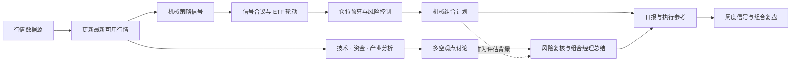

<div align="center">


### 让机械策略保持纪律，让 AI 分析拓展视角

**ETF Compass** 是面向 ETF 投资研究的 AI Agent：以可验证的量化策略构建组合计划，再用多视角 AI 分析补充信息、质疑假设、识别风险。

[](https://www.python.org/)
[](LICENSE)
[](#项目状态)

[English](#english) · [快速开始](#快速开始) · [系统流程](#系统流程)

</div>

ETF Compass 将两种能力放进同一研究流程：**机械策略**按明确规则筛选 ETF、控制仓位并形成可复核的计划；**AI 分析**从技术、资金和产业等角度阅读最新市场信息，通过多空讨论和风险复核补充判断。规则提供一致性，AI 提供信息整合与反方审视，最终结论保留证据和不确定性，供使用者判断。

## 系统流程



日常流程应在生成信号前刷新行情，并检查数据时间与完整性。接入应用可据此生成日报、按周整理模型前瞻评估和轮动表现，并配置邮件或其他推送方式。当前公开 Python 包提供策略、仓位和 AI 讨论核心；具体行情供应商、定时任务与消息投递由部署层接入。

## 机械策略与仓位控制

ETF Compass 提供多类互补的价格信号，合议后用于横截面轮动和候选筛选：

| 策略 | 核心思路 |
| --- | --- |
| 海龟通道突破 | 观察价格突破近期高低区间，跟随趋势变化 |
| 标准化动量 | 衡量一段时间的相对强弱，并按波动水平标准化 |
| 双动量 | 同时比较资产间强弱，并检查绝对动量方向 |
| RSI 均值回归 | 识别短期超卖状态，等待价格修复信号 |
| ATR 波动率突破 | 结合均线与真实波幅识别趋势突破和退出状态 |

多信号可以等权合议。组合侧提供 Top-K 与持仓缓冲，并按历史波动估算目标权重，限制单项仓位和总敞口。信号只使用已观测行情；策略执行时点、成本和组合规则应在回测与部署中保持一致。

## AI 多视角分析

AI 层采用 TradingAgents 风格的协作流程，对机械计划提供独立复核：

1. 技术、资金和产业分析角色分别整理输入的市场事实。
2. 多方与审慎方围绕证据展开多轮讨论，呈现支持理由、反例和信息缺口。
3. 风险角色检查下行情景和关键假设，组合经理将结论整理为结构化观点、信心、风险与观察项。

AI 的作用是补充分析、检验论据和提示风险。组合信号仍由机械策略计算，模型评估不会覆盖策略结果或生成交易指令。

模型供应商可替换。公开包通过调用者提供的 `complete(prompt)` 适配函数连接模型服务；可在应用层配置兼容的 API。多角色和多轮讨论会产生多次模型请求，成本随角色数量和讨论轮数变化。**API key 只应保存在本地环境变量或密钥管理服务中，不要写入源码、README、日志或 Git 历史。**本仓库不包含任何个人 API key。

## 日报与周度复盘

部署后的日常工作流可将最新行情、轮动结果、目标仓位、风险提示和 AI 评估整理成日报；周度复盘可汇总前瞻信号表现、轮动质量及需要继续验证的问题。推送渠道和运行时间由部署环境配置，公开核心包不绑定个人账户、邮箱或推送凭据。

## 快速开始

需要 Python 3.11 或更高版本：

```bash
git clone https://github.com/BZX667/ETF-Compass.git
cd ETF-Compass
python -m pip install -e '.[dev]'
```

示例展示如何生成策略信号、筛选候选和计算仓位。行情面板、历史收益、持仓快照、事实摘要及 `my_model_adapter` 由配置的数据源和部署应用提供：

```python
import pandas as pd

from etf_compass import equal_weight_ensemble, momentum_score, select_assets
from etf_compass import turtle_breakout, volatility_target_weights
from etf_compass.agents import run_trading_agents_review

# close 为按日期索引、按 ETF 代码分列的最新价格面板。
signals = {
    "momentum": momentum_score(close),
    "turtle": turtle_breakout(close).astype(float),
}
scores = equal_weight_ensemble(signals).iloc[-1].dropna()
selected = select_assets(scores, top_k=4, held=current_holdings, buffer_multiple=1.25)

# returns 使用决策时点之前的历史收益，避免前视数据。
weights = volatility_target_weights(
    returns, selected, target_volatility=0.15, lookback=20, max_weight=0.35
)

review = run_trading_agents_review(
    facts={"technical": technical_facts, "industry": industry_facts},
    mechanical_plan=f"目标权重：{weights.to_dict()}",
    complete=my_model_adapter,  # 在应用层接入你选择的模型与 API key
    rounds=2,
)
```

## 开发与验证

```bash
python -m pytest
```

回测表现受样本区间、标的范围、数据质量、交易成本和执行时点影响。请检查样本外结果与数据时序，不把历史指标或模型观点视为未来收益保证。

## 项目状态与风险说明

ETF Compass 目前处于研究原型阶段，模块接口仍可能调整。行情供应商、账户管理、自动调度和推送属于部署集成内容。本项目仅用于技术研究，不构成投资建议或交易邀约；金融市场存在本金损失风险，请独立评估并验证所有策略与模型输出。

---

<a id="english"></a>

## English

### Systematic strategies for discipline. AI analysis for perspective.

**ETF Compass** is an AI agent for ETF investment research. It combines rule-based portfolio construction with multi-perspective AI analysis: systematic signals produce a reviewable plan, while AI organizes current market evidence, challenges assumptions, and highlights risks.

The two approaches contribute different strengths. Mechanical strategies apply consistent, testable rules. AI analysis synthesizes technical, flow, and industry information and brings forward counterarguments. The result is a more complete research view; the portfolio signal remains rule-based, and the final decision remains with the user.

### Workflow

Before calculating signals, the integrated application fetches the latest available market data from its configured provider and checks timestamps and completeness. Mechanical signals are combined into an ETF rotation and position plan. In parallel, analyst roles review market facts, bull and cautious perspectives debate the evidence, and risk review plus a portfolio manager produce a structured assessment. Daily reports can bring together the plan and AI view; weekly reviews can summarize forward-signal quality and rotation results. Scheduling and delivery are configured by the deployment application.

### Strategy toolkit

ETF Compass combines complementary price-based signals for ETF ranking and portfolio construction:

| Strategy | Approach |
| --- | --- |
| Turtle-style channel breakout | Follows price breaks above or below recent channel levels |
| Normalized momentum | Measures trailing relative strength and scales it by its variability |
| Dual momentum | Combines cross-asset ranking with a positive absolute-momentum filter |
| RSI mean reversion | Identifies short-term oversold conditions and recovery |
| ATR volatility breakout | Uses a moving-average band and true range to identify breakouts and exits |

Signals can be combined with equal weights and used for buffered Top-K rotation. Portfolio sizing supports volatility targeting, per-asset caps, and a total exposure limit. Use point-in-time data and align backtests with the intended execution timing and costs.

### TradingAgents-style AI review

Technical, flow, and industry analyst roles summarize supplied facts. Bull and cautious researchers debate the evidence over configurable rounds. A risk reviewer checks downside cases, and a portfolio manager returns a structured view with confidence, evidence, risks, and watch items. The AI assessment is advisory: it does not replace the mechanical signal or issue orders.

The model provider is configurable through a caller-supplied `complete(prompt)` adapter. Multiple roles and debate rounds result in multiple model calls, so request volume depends on the configured workflow. API credentials belong in the application environment or a secrets manager. **Do not commit API keys to source code, documentation, logs, or Git history. No personal API key is included in this repository.**

### Daily reports and weekly review

In a deployed workflow, the latest quotes, rotation results, target weights, risk notes, and AI assessment can be assembled into a daily report. Weekly reviews can summarize forward-signal quality, rotation results, and open research questions. The deployment application configures the schedule and delivery channel; this package does not include a personal account, mailbox, or push credential.

### Quick start

Requires Python 3.11 or later:

```bash
git clone https://github.com/BZX667/ETF-Compass.git
cd ETF-Compass
python -m pip install -e '.[dev]'
```

The example below assumes the deployment application has prepared the price and return panels, the current holdings snapshot, verified facts, and a configured model adapter:

```python
import pandas as pd

from etf_compass import equal_weight_ensemble, momentum_score, select_assets
from etf_compass import turtle_breakout, volatility_target_weights
from etf_compass.agents import run_trading_agents_review

signals = {
    "momentum": momentum_score(close),
    "turtle": turtle_breakout(close).astype(float),
}
scores = equal_weight_ensemble(signals).iloc[-1].dropna()
selected = select_assets(scores, top_k=4, held=current_holdings, buffer_multiple=1.25)

# Use only returns observed before the intended execution period.
weights = volatility_target_weights(
    returns, selected, target_volatility=0.15, lookback=20, max_weight=0.35
)

review = run_trading_agents_review(
    facts={"technical": technical_facts, "industry": industry_facts},
    mechanical_plan=f"Target weights: {weights.to_dict()}",
    complete=my_model_adapter,
    rounds=2,
)
```

### Development and risk

```bash
python -m pytest
```

ETF Compass is a research prototype, not investment advice or a trading solicitation. Backtest results depend on the sample, universe, data quality, transaction costs, and execution timing. Historical results and model assessments do not guarantee future performance. Validate data, assumptions, and out-of-sample behavior independently.

ETF Compass is a research prototype, not investment advice. Historical results and model assessments do not guarantee future performance. Validate data, assumptions, transaction costs, and out-of-sample behavior independently.
