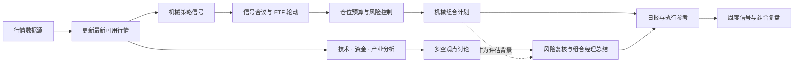

<div align="center">


### 让机械策略保持纪律，让 AI 分析拓展视角

**ETF Compass** 是面向 ETF 投资研究的 AI Agent：以可验证的量化策略构建组合计划，再用多视角 AI 分析补充信息、质疑假设、识别风险。

[](https://www.python.org/)
[](LICENSE)
[](#项目状态)

[English](#english) · [快速开始](#快速开始) · [系统流程](#系统流程)

</div>

ETF Compass 将两种能力放进同一研究流程：**机械策略**按明确规则筛选 ETF、控制仓位并形成可复核的计划；**AI 分析**从技术、资金和产业等角度阅读最新市场信息，通过多空讨论和风险复核补充判断。规则提供一致性，AI 提供信息整合与反方审视，最终结论保留证据和不确定性，供使用者判断。

## 系统流程



日常流程应在生成信号前刷新行情，并检查数据时间与完整性。接入应用可据此生成日报、按周整理模型前瞻评估和轮动表现，并配置邮件或其他推送方式。当前公开 Python 包提供策略、仓位和 AI 讨论核心；**日报/周报编排、持久化、定时任务和消息投递尚未包含在这个包内**，由部署层接入。

当前包接收调用方准备好的行情面板、收益序列和事实摘要，不直接连接行情供应商。完整应用应在计算信号前拉取最新可用数据，并将数据时间戳、缺失值和覆盖率传入报告；不要把陈旧缓存描述为最新行情。

## 机械策略与仓位控制

ETF Compass 提供多类互补的价格信号，合议后用于横截面轮动和候选筛选：

| 策略 | 核心思路 |
| --- | --- |
| 海龟通道突破 | 观察价格突破近期高低区间，跟随趋势变化 |
| 标准化动量 | 衡量一段时间的相对强弱，并按波动水平标准化 |
| 双动量 | 同时比较资产间强弱，并检查绝对动量方向 |
| RSI 均值回归 | 识别短期超卖状态，等待价格修复信号 |
| ATR 波动率突破 | 结合均线与真实波幅识别趋势突破和退出状态 |

多信号可以等权合议。组合侧提供 Top-K 与持仓缓冲，并按历史波动估算目标权重，限制单项仓位和总敞口。信号只使用已观测行情；策略执行时点、成本和组合规则应在回测与部署中保持一致。

## AI 多视角分析（参考 [TradingAgents](https://github.com/TauricResearch/TradingAgents)）

AI 层采用 [TradingAgents](https://github.com/TauricResearch/TradingAgents) 风格的协作流程，对机械计划提供独立复核：

1. 调用方可以提供技术、资金、产业等事实组；每组由对应分析角色整理证据和不确定性。
2. 多方与审慎方围绕证据展开多轮讨论，呈现支持理由、反例和信息缺口。
3. 风险角色检查下行情景和关键假设，组合经理将结论整理为结构化观点、信心、风险与观察项。

AI 的作用是补充分析、检验论据和提示风险。组合信号仍由机械策略计算，模型评估不会覆盖策略结果或生成交易指令。

模型供应商可替换。公开包通过调用者提供的 `complete(prompt)` 适配函数连接模型服务；可在应用层配置兼容的 API。`facts` 中的每个输入组会作为一个分析角色，多方与审慎方按配置轮数讨论，然后由风险审查和组合研究经理形成结构化评估。多角色和多轮讨论会产生多次模型请求，成本随输入组和讨论轮数变化。**API key 只应保存在本地环境变量或密钥管理服务中，不要写入源码、README、日志或 Git 历史。**本仓库不包含任何个人 API key。

## 日报、周度复盘与推送

下面描述的是使用公开核心包搭建的应用层流程；这些报告和推送目前不是仓库中可直接运行的命令。

| 频率 | 建议内容 | 数据要求 |
| --- | --- | --- |
| 日报 | 行情数据时间与覆盖率、轮动排名和信号、目标权重、风险提示、AI 观点/置信度/证据/风险/观察项 | 先刷新最新可用行情；把价格时间戳和缺失标的列入报告，避免用过期或不完整数据悄悄生成计划 |
| 周度复盘 | 机械信号与 AI 前瞻观点的样本数、方向命中或基准超额、轮动变化、待验证问题；如需账户盈亏，另由部署应用选择性接入本地账本 | 保存每日决策时点的信号和 AI 观点快照；按预先指定的评估周期和基准回看，披露样本数。仅当部署者提供交易账本时才报告账户实际盈亏 |

生成日报时，可以把 `select_assets`、`volatility_target_weights` 的结果与 `run_trading_agents_review` 的结构化评估一起渲染为 Markdown 或 HTML。周复盘应使用当时保存的观点和信号计算前瞻结果，避免事后重算输入造成时间穿越；公开包目前不提供这些数据的存档或周度评分流程。

### 邮件与企业微信

公开包没有内置邮件账号、微信凭据或发送客户端。部署应用可以从环境变量读取密钥，并把同一份 Markdown 日报/周报分别交给邮件和企业微信群机器人。SMTP_SSL 可用于邮件；企业微信群机器人通过 Webhook 接收 JSON Markdown 消息（参见[企业微信消息推送文档](https://developer.work.weixin.qq.com/document/path/91770)）。个人微信不是这个群机器人接口的接收端；个人账号推送需另选合规的第三方通知服务。

示例代码使用以下环境变量：

| 变量 | 用途 |
| --- | --- |
| `SMTP_HOST`、`SMTP_PORT` | 邮箱服务商的 SMTP SSL 主机和端口（常见端口为 465，按服务商设置） |
| `SMTP_USER`、`SMTP_PASSWORD` | 发件邮箱和应用专用密码 |
| `REPORT_TO` | 报告收件邮箱 |
| `WECOM_BOT_WEBHOOK` | 企业微信群机器人完整 Webhook URL；按机密凭据保管 |

下面是部署层示例，环境变量都应在运行环境或密钥管理服务中设置，不能写入仓库。SMTP 主机和端口需按邮箱服务商配置；`WECOM_BOT_WEBHOOK` 整条 URL 都是秘密：

```python
import json
import os
import smtplib
import ssl
from email.message import EmailMessage
from urllib.request import Request, urlopen


def send_email(subject: str, body: str) -> None:
    message = EmailMessage()
    message["Subject"] = subject
    message["From"] = os.environ["SMTP_USER"]
    message["To"] = os.environ["REPORT_TO"]
    message.set_content(body)
    with smtplib.SMTP_SSL(
        os.environ["SMTP_HOST"], int(os.environ.get("SMTP_PORT", "465")),
        context=ssl.create_default_context(), timeout=20,
    ) as smtp:
        smtp.login(os.environ["SMTP_USER"], os.environ["SMTP_PASSWORD"])
        smtp.send_message(message)


def send_wecom_markdown(body: str) -> None:
    request = Request(
        os.environ["WECOM_BOT_WEBHOOK"],
        data=json.dumps({"msgtype": "markdown", "markdown": {"content": body}}).encode(),
        headers={"Content-Type": "application/json"},
        method="POST",
    )
    with urlopen(request, timeout=15) as response:
        result = json.loads(response.read())
    if result.get("errcode") != 0:
        raise RuntimeError(f"WeCom delivery failed: errcode={result.get('errcode')}")
```

给个人邮箱或企业微信群发送账户级别内容前，应确认收件范围和内容；如果只需公开市场摘要，就不要把个人持仓、账本或账户价值放进消息。Webhook 和 API key 不得提交到 Git，也不要在日志中打印完整 URL 或凭据。

定时运行由部署应用配置（例如 cron 或 systemd timer），并自行处理时区、交易日/节假日、失败重试和重复发送。定时任务应调用你自己的报告编排入口；本仓库没有 `daily_report` / `weekly_report` 命令或默认时间表。

## 快速开始

需要 Python 3.11 或更高版本：

```bash
git clone https://github.com/BZX667/ETF-Compass.git
cd ETF-Compass
python -m pip install -e '.[dev]'
```

示例展示如何生成策略信号、筛选候选和计算仓位。行情面板、历史收益、持仓快照、事实摘要及 `my_model_adapter` 由配置的数据源和部署应用提供：

```python
from etf_compass import equal_weight_ensemble, momentum_score, select_assets
from etf_compass import turtle_breakout, volatility_target_weights
from etf_compass.agents import run_trading_agents_review

# close 为按日期索引、按 ETF 代码分列的最新价格面板。
signals = {
    "momentum": momentum_score(close),
    "turtle": turtle_breakout(close).astype(float),
}
scores = equal_weight_ensemble(signals).iloc[-1].dropna()
selected = select_assets(scores, top_k=4, held=current_holdings, buffer_multiple=1.25)

# returns 使用决策时点之前的历史收益，避免前视数据。
weights = volatility_target_weights(
    returns, selected, target_volatility=0.15, lookback=20, max_weight=0.35
)

review = run_trading_agents_review(
    facts={"technical": technical_facts, "industry": industry_facts},
    mechanical_plan=f"目标权重：{weights.to_dict()}",
    complete=my_model_adapter,  # 在应用层接入你选择的模型与 API key
    rounds=2,
)
```

## 开发与验证

```bash
python -m pytest
```

回测表现受样本区间、标的范围、数据质量、交易成本和执行时点影响。请检查样本外结果与数据时序，不把历史指标或模型观点视为未来收益保证。

## 项目状态与风险说明

ETF Compass 目前处于研究原型阶段，模块接口仍可能调整。行情供应商、账户管理、自动调度和推送属于部署集成内容。本项目仅用于技术研究，不构成投资建议或交易邀约；金融市场存在本金损失风险，请独立评估并验证所有策略与模型输出。

---

<a id="english"></a>

## English

### Systematic strategies for discipline. AI analysis for perspective.

**ETF Compass** is an AI agent for ETF investment research. It combines rule-based portfolio construction with multi-perspective AI analysis: systematic signals produce a reviewable plan, while AI organizes current market evidence, challenges assumptions, and highlights risks.

The two approaches contribute different strengths. Mechanical strategies apply consistent, testable rules. AI analysis synthesizes technical, flow, and industry information and brings forward counterarguments. The result is a more complete research view; the portfolio signal remains rule-based, and the final decision remains with the user.

### Workflow

Before calculating signals, the integrated application fetches the latest available market data from its configured provider and checks timestamps and completeness. Mechanical signals are combined into an ETF rotation and position plan. In parallel, analyst roles review market facts, bull and cautious perspectives debate the evidence, and risk review plus a portfolio manager produce a structured assessment. Daily reports can bring together the plan and AI view; weekly reviews can summarize forward-signal quality and rotation results. Scheduling and delivery are configured by the deployment application.

The package consumes price panels, return series, and fact summaries prepared by its caller; it does not connect directly to a market-data vendor. A complete application should fetch the latest available data before calculating signals and surface timestamps, missing values, and coverage in its report. Do not label a stale cache as current market data.

### Strategy toolkit

ETF Compass combines complementary price-based signals for ETF ranking and portfolio construction:

| Strategy | Approach |
| --- | --- |
| Turtle-style channel breakout | Follows price breaks above or below recent channel levels |
| Normalized momentum | Measures trailing relative strength and scales it by its variability |
| Dual momentum | Combines cross-asset ranking with a positive absolute-momentum filter |
| RSI mean reversion | Identifies short-term oversold conditions and recovery |
| ATR volatility breakout | Uses a moving-average band and true range to identify breakouts and exits |

Signals can be combined with equal weights and used for buffered Top-K rotation. Portfolio sizing supports volatility targeting, per-asset caps, and a total exposure limit. Use point-in-time data and align backtests with the intended execution timing and costs.

### [TradingAgents](https://github.com/TauricResearch/TradingAgents)-style AI review

The caller can provide technical, flow, industry, or other fact groups, each summarized by an analyst role. Bull and cautious researchers debate the evidence over configurable rounds. A risk reviewer checks downside cases, and a portfolio manager returns a structured view with confidence, evidence, risks, and watch items. The AI assessment is advisory: it does not replace the mechanical signal or issue orders.

The model provider is configurable through a caller-supplied `complete(prompt)` adapter. Each supplied `facts` group becomes an analyst role; bull and cautious researchers debate for the configured number of rounds, followed by risk review and a structured portfolio research assessment. Multiple roles and debate rounds result in multiple model calls, so request volume depends on the configured workflow. API credentials belong in the application environment or a secrets manager. **Do not commit API keys to source code, documentation, logs, or Git history. No personal API key is included in this repository.**

### Daily reports, weekly reviews, and delivery

The following describes an application built on this package. Report generation, persistence, scheduling, and delivery are **not currently implemented as runnable commands in this repository**.

| Cadence | Suggested contents | Data requirements |
| --- | --- | --- |
| Daily | Quote timestamp and coverage, rotation ranks and signals, target weights, risk notes, and the AI stance, confidence, evidence, risks, and watch items | Refresh the latest available quotes first. Report timestamps and missing assets so stale or incomplete input is visible |
| Weekly | Sample counts and forward results for mechanical signals and AI views, benchmark-relative performance, rotation changes, and open research questions. Account P&L is optional and requires a separately supplied local ledger | Persist point-in-time signals and AI views. Evaluate them at a predeclared horizon against a chosen benchmark and report sample counts; only report realized account P&L when the deployment explicitly supplies a trade ledger |

An application can render the outputs of `select_assets`, `volatility_target_weights`, and `run_trading_agents_review` as Markdown or HTML for a daily report. A weekly review should use the saved decision-time inputs to avoid look-ahead from recomputing signals after the fact. This package does not yet store these snapshots or calculate a weekly scorecard.

#### Email and WeCom

The package does not include mailboxes, WeChat credentials, or delivery clients. A deployment can load secrets from environment variables or a secrets manager and send the same Markdown report by SMTP over SSL and to an enterprise WeChat group robot Webhook. See the [WeCom message-push documentation](https://developer.work.weixin.qq.com/document/path/91770). A personal WeChat account is not the recipient for this group-robot endpoint; personal-account delivery requires a separate supported notification service.

The example uses these environment variables:

| Variable | Purpose |
| --- | --- |
| `SMTP_HOST`, `SMTP_PORT` | Mail provider's SMTP SSL host and port (465 is common; follow your provider's settings) |
| `SMTP_USER`, `SMTP_PASSWORD` | Sender mailbox and app-specific password |
| `REPORT_TO` | Report recipient |
| `WECOM_BOT_WEBHOOK` | Full enterprise WeChat group robot Webhook URL; treat it as a secret |

The following deployment example keeps credentials outside the repository. Configure the SMTP host and port for your mail provider. Treat the entire `WECOM_BOT_WEBHOOK` URL as a secret:

```python
import json
import os
import smtplib
import ssl
from email.message import EmailMessage
from urllib.request import Request, urlopen


def send_email(subject: str, body: str) -> None:
    message = EmailMessage()
    message["Subject"] = subject
    message["From"] = os.environ["SMTP_USER"]
    message["To"] = os.environ["REPORT_TO"]
    message.set_content(body)
    with smtplib.SMTP_SSL(
        os.environ["SMTP_HOST"], int(os.environ.get("SMTP_PORT", "465")),
        context=ssl.create_default_context(), timeout=20,
    ) as smtp:
        smtp.login(os.environ["SMTP_USER"], os.environ["SMTP_PASSWORD"])
        smtp.send_message(message)


def send_wecom_markdown(body: str) -> None:
    request = Request(
        os.environ["WECOM_BOT_WEBHOOK"],
        data=json.dumps({"msgtype": "markdown", "markdown": {"content": body}}).encode(),
        headers={"Content-Type": "application/json"},
        method="POST",
    )
    with urlopen(request, timeout=15) as response:
        result = json.loads(response.read())
    if result.get("errcode") != 0:
        raise RuntimeError(f"WeCom delivery failed: errcode={result.get('errcode')}")
```

Before sending account-level content to a mailbox or group, verify the recipients and message contents. Keep private holdings and ledger data out of public summaries unless explicitly needed. Never commit Webhook URLs or API keys, and do not print full credentials in logs.

Scheduling belongs to the deployment application (for example, cron or a systemd timer), which must handle time zones, market holidays, retries, and duplicate sends. The scheduled command should call your own report orchestrator; this repository has no `daily_report` or `weekly_report` command or default schedule.

### Quick start

Requires Python 3.11 or later:

```bash
git clone https://github.com/BZX667/ETF-Compass.git
cd ETF-Compass
python -m pip install -e '.[dev]'
```

The example below assumes the deployment application has prepared the price and return panels, the current holdings snapshot, verified facts, and a configured model adapter:

```python
from etf_compass import equal_weight_ensemble, momentum_score, select_assets
from etf_compass import turtle_breakout, volatility_target_weights
from etf_compass.agents import run_trading_agents_review

signals = {
    "momentum": momentum_score(close),
    "turtle": turtle_breakout(close).astype(float),
}
scores = equal_weight_ensemble(signals).iloc[-1].dropna()
selected = select_assets(scores, top_k=4, held=current_holdings, buffer_multiple=1.25)

# Use only returns observed before the intended execution period.
weights = volatility_target_weights(
    returns, selected, target_volatility=0.15, lookback=20, max_weight=0.35
)

review = run_trading_agents_review(
    facts={"technical": technical_facts, "industry": industry_facts},
    mechanical_plan=f"Target weights: {weights.to_dict()}",
    complete=my_model_adapter,
    rounds=2,
)
```

### Development and risk

```bash
python -m pytest
```

ETF Compass is a research prototype, not investment advice or a trading solicitation. Backtest results depend on the sample, universe, data quality, transaction costs, and execution timing. Historical results and model assessments do not guarantee future performance. Validate data, assumptions, and out-of-sample behavior independently.
