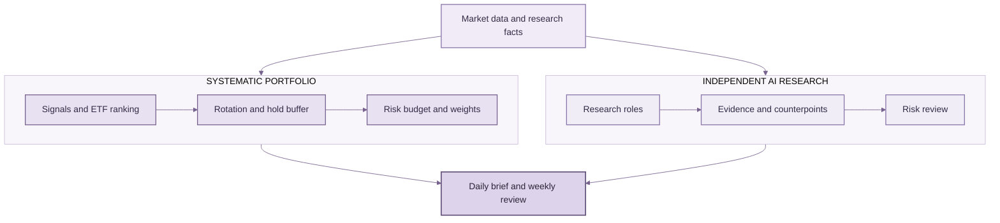

<div align="center">


# ETF Compass 🧭

### Build Your Own AI-Powered ETF Trading Agent

**An open, extensible ETF research framework combining systematic signals, portfolio risk controls, and independent AI research.**

Systematic signals. Independent AI research. You stay in control.

[](https://www.python.org/)
[](LICENSE)
[](#testing)

[中文](README_zh.md) · [Quick Start](#quick-start) · [Research Case](#reproducible-research-case)

<a href="assets/report-preview.svg"></a>

<sub>Illustrative daily report preview · fictional sample values · <a href="assets/report-preview.svg">View full size</a></sub>

</div>

ETF Compass combines rule-based ETF selection and position sizing with an AI research workflow that tests evidence, counterarguments, and portfolio risks. The strategy produces an auditable portfolio plan; AI adds a separate research view and does not rewrite the strategy weights or place orders.

## How it works



Systematic strategy and AI research complement each other: portfolio rules determine the candidate allocation, while AI independently examines the evidence and risks. Daily and weekly report rendering and delivery-channel functions are included; data feeds, model credentials, and scheduling are supplied by the integrating application.

## Quick start

Python 3.11 or newer. The offline demo needs only the core dependencies and prints a complete backtest summary using deterministic synthetic data:

```bash
git clone https://github.com/BZX667/ETF-Compass.git
cd ETF-Compass
python -m pip install -e '.[dev]'
python examples/quickstart.py
```

This is a runnable software demo, not a market-data result or investment claim. ETF Compass does not currently provide a general-purpose command-line interface or bundled market-data feed.

## Reproducible research case

Run a fixed 2010–2024 historical study using adjusted daily prices for five long-running U.S.-listed ETFs. It applies positive 126-session momentum, selects up to two funds, estimates risk from the prior 20 sessions, models next-session closing execution, and charges 6 bps per one-way turnover. The script downloads the public price history and saves a report with its date range, assumptions, and a hash of the aligned price panel.

```bash
python -m pip install -e '.[research]'
python examples/public_research_case.py
```

The checked-in [research result](examples/results/public-etf-research-case.md) reports a 6.46% annualized return for the rotation example and 5.11% for the SPY comparison over this sample. It retrieves adjusted daily prices from [Yahoo Finance](https://finance.yahoo.com/quote/SPY/history/) through [yfinance](https://ranaroussi.github.io/yfinance/reference/api/yfinance.download.html). This is one retrospective example, not an independently validated strategy, and should not be read as evidence of future performance. Yahoo Finance may revise historical data, so a later download can produce different results. The study uses U.S. daily data and does not validate intraday, A-share, or QDII execution.

## What is included

- **Systematic strategy:** trend breakout, normalized momentum, dual momentum, RSI mean reversion, and ATR breakout signals; score-based ETF rotation with a holding buffer; volatility-targeted sizing with single-name and gross-exposure limits.
- **Historical research:** a daily rotation backtest with close-signal/next-session-close execution, turnover costs, benchmark comparison, and performance summary. The caller supplies prices and scores.
- **AI research:** a pluggable multi-role analyst workflow with evidence, opposing views, risk review, and a structured final assessment. The caller supplies a model completion function; no model provider or API key is bundled.
- **Reports:** Markdown/HTML daily reports, weekly forward-observation reviews, and email/WeChat delivery functions. Market-data ingestion, account ledger, and scheduled jobs remain application integrations.

## Extend it your way

Bring your own factors, ETF universe, portfolio rules, market data, and AI models. Combine the pieces around your research process and keep evolving your own ETF Trading Agent.

## Testing

```bash
python -m pip install -e '.[dev]'
pytest
```

The tests cover signal behavior, portfolio constraints, execution timing and costs, report rendering, notification behavior, and AI-workflow output validation.

## Scope

ETF Compass is a research framework, not a broker or an investment adviser. Historical results depend on data quality, universe selection, evaluation windows, execution assumptions, and transaction costs. Validate each strategy independently before using it in a live setting.
