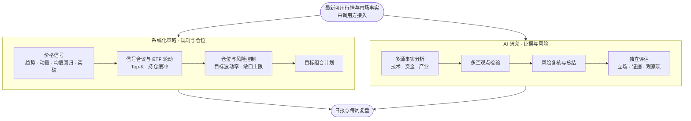
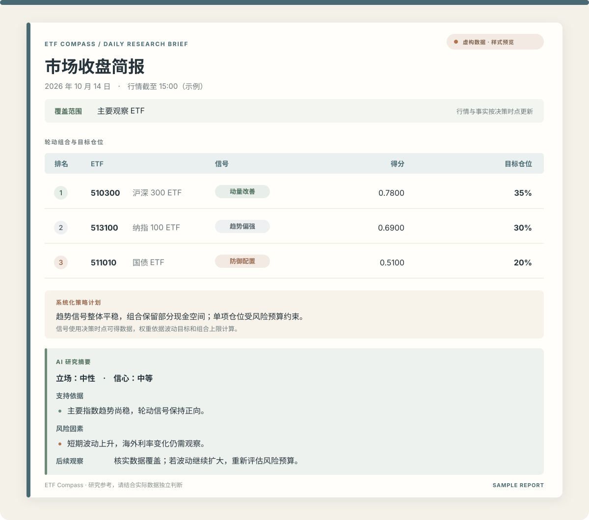

<div align="center">


### 让策略保持纪律，让 AI 分析拓展视角

**ETF Compass 是一个面向 ETF 研究的开源 Python 工具包：量化策略生成可复核的组合计划，AI 多视角分析补充证据、挑战假设并识别风险。**

[](https://www.python.org/)
[](LICENSE)
[](#项目状态)

[English](#english) · [快速开始](#快速开始) · [报告与推送](#报告与推送)

</div>

系统化量化策略以一致、可测试的规则生成组合信号；AI 分析整合技术、资金与产业事实，经过多空讨论和风险复核后给出独立评估。两者优势互补：策略负责信号、轮动与仓位约束，AI 帮助扩大研究视角；AI 观点不会覆盖策略信号，也不会自动下单。

## 工作流程



AI 以同一组行情与市场事实为输入，并把策略计划作为评估背景；它提供独立观点与风险审视，不覆盖策略信号。

## 系统化策略 + AI 分析

| 策略 | 核心思路 |
| --- | --- |
| 海龟通道突破 | 跟踪价格突破近期区间及趋势退出信号 |
| 标准化动量 | 衡量相对强度，并按波动水平标准化 |
| 双动量 | 比较资产间强弱，并过滤绝对动量为负的标的 |
| RSI 均值回归 | 识别短期超卖状态与潜在修复信号 |
| ATR 波动率突破 | 结合均线和真实波幅跟踪趋势变化 |

多信号可等权合议，用于横截面排名和 Top-K 轮动；持仓缓冲减少排名边缘的频繁切换。仓位模块按历史波动估算风险目标，并限制单项权重和组合总敞口。计算信号时应使用决策时点可获得的数据，并按实际执行时点评估结果。

AI 工作流由事实分析、多空研究、风险审查和组合经理总结组成，输出立场、信心、证据、风险与观察项。相关项目：[TradingAgents](https://github.com/TauricResearch/TradingAgents)。模型供应商由调用方提供的适配器接入，可使用兼容 API 或本地模型；也可按研究需要扩展事实输入和分析角色。

### 按需扩展，自己 DIY

ETF Compass 提供可组合的 Python 模块，方便你基于现有代码继续 DIY：添加自己的量化信号，调整 ETF 筛选与轮动规则，或定制仓位和风险控制方法。AI 分析可接入你选择的模型，补充自己的行情与研究资料，并按需求调整分析角色和工作流。策略与模型扩展后，应使用一致的数据时点和执行假设独立验证。

## 报告与推送

支持生成并推送每日策略简报与每周复盘。日报呈现行情、策略组合和 AI 研究摘要；周报回顾轮动表现与已到期观点。报告是策略与 AI 研究的辅助输出。

<div align="center">
  <a href="assets/report-preview.svg">
    
  </a>
  <br>
  <sub>每日简报样式预览 · 点击图片查看原图 · 所有数值均为虚构示例</sub>
</div>

HTML 日报可用于邮件或浏览器查看；微信渠道发送适配的文本版。报告中的行情、账户信息与推送渠道由使用者的部署应用提供；本仓库不包含私人账户数据或推送密钥。

## 快速开始

需要 Python 3.11 或更高版本：

```bash
git clone https://github.com/BZX667/ETF-Compass.git
cd ETF-Compass
python -m pip install -e '.[dev]'
python -m pytest
```

以下是应用侧集成示意。策略函数接收调用方准备的行情面板，不直接连接行情供应商：

```python
from etf_compass import (
    equal_weight_ensemble, momentum_score, select_assets,
    volatility_target_weights, turtle_breakout,
)
from etf_compass.agents import run_trading_agents_review
from etf_compass import render_daily_report, render_daily_report_html, send_report

signals = {"momentum": momentum_score(close), "turtle": turtle_breakout(close)}
scores = equal_weight_ensemble(signals).iloc[-1].dropna()
selected = select_assets(scores, top_k=4, held=current_holdings, buffer_multiple=1.25)
weights = volatility_target_weights(returns, selected, max_weight=0.35)

review = run_trading_agents_review(
    facts={"technical": technical_facts, "industry": industry_facts},
    mechanical_plan=f"Target weights: {weights.to_dict()}",
    complete=my_model_adapter,  # credentials stay in the calling application
)
report_inputs = dict(
    as_of=report_date,
    market_data_as_of=quote_timestamp,
    rotation=[{"symbol": symbol, "score": scores[symbol], "weight": weights[symbol]} for symbol in selected],
    assessment=review.assessment,
    market_coverage="selected ETF universe",
)
text_report = render_daily_report(**report_inputs)
html_report = render_daily_report_html(**report_inputs)
send_report("ETF daily research", text_report, html_body=html_report, channels=("email", "serverchan"))
```

周复盘可使用 `ForwardObservation` 保存每次观点的观察日、评估结束日、立场、标的收益和基准收益，再调用 `score_forward_observations(..., as_of=review_date)` 与 `render_weekly_review(...)`。收益区间必须从观察日之后开始，并统一基准和持有期；仅已结束的样本进入评分。

## 项目状态与风险说明

ETF Compass 处于研究原型阶段。它不提供交易执行，也不保证收益。数据质量、幸存者偏差、评估窗口、交易成本和执行时点都会影响结果；应独立验证策略和 AI 输出，不把历史表现视为未来保证。本项目不构成投资建议。

---

<a id="english"></a>

## English

**ETF Compass is an open-source Python toolkit for ETF research, combining systematic rotation and risk controls with AI-assisted analysis.** It includes daily and weekly report helpers, with optional email and WeChat delivery. Market data, model access, credentials, and scheduling are supplied by the deploying application; no personal keys, account details, or trading records are included. The project is a research prototype and does not execute trades or provide investment advice.
