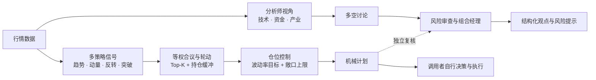

<div align="center">


### 让规则负责组合，让 AI 提供独立视角

一个模块化的 ETF 投资研究 Agent：机械轮动、仓位风险控制与 LLM 评估，各自有清晰边界。

[](https://www.python.org/)
[](LICENSE)
[](#项目状态)

**[English](#english)** · **[快速开始](#快速开始)** · **[系统设计](#系统设计)**

</div>

ETF Compass 是一个轻量、可审阅的 ETF 投资研究 Agent。它把趋势、动量、均值回归和波动突破等规则信号合成为候选排序，经过仓位风险控制形成机械计划；LLM 则按 TradingAgents 风格组织分析师、多空观点、风险审查和组合经理总结，给出独立评估。AI 意见不会改写机械计划，也不会触发交易。

## 系统设计



| 模块 | 做什么 | 保持的边界 |
| --- | --- | --- |
| 轮动筛选 | 根据调用者提供的分数选出 Top-K，并支持持仓缓冲 | 不拉取行情、不替用户生成分数 |
| 策略信号 | 海龟通道突破、标准化动量、双动量、RSI 均值回归、ATR 波动率突破；支持等权合议 | 信号在当前 bar 收盘后形成，执行时点由调用者控制 |
| 仓位控制 | 根据历史波动估算权重，并限制单资产和总敞口 | 输入必须截止于计划执行期之前 |
| LLM 评估 | 多角色分析、正反观点多轮讨论、风险审查、组合经理结构化总结 | 模型只做独立评估，不改写机械计划、不下单 |

## 快速开始

需要 Python 3.11 或更高版本。

```bash
git clone https://github.com/BZX667/ETF-Compass.git
cd ETF-Compass
python -m pip install -e '.[dev]'
```

## 示例

```python
import pandas as pd

from etf_compass import select_assets, volatility_target_weights
from etf_compass.agents import run_trading_agents_review
from etf_compass.signals import equal_weight_ensemble, momentum_score, turtle_breakout

close = pd.DataFrame(
    {
        "ETF_A": [100 + i * 0.8 + (i % 5) for i in range(260)],
        "ETF_B": [100 + i * 0.4 + (i % 7) for i in range(260)],
        "ETF_C": [100 + i * 0.2 + (i % 3) for i in range(260)],
    }
)
signals = {
    "momentum": momentum_score(close),
    "turtle": turtle_breakout(close).astype(float),
}
combined = equal_weight_ensemble(signals)
scores = combined.iloc[-1].dropna()
selected = select_assets(scores, top_k=2, held=[], buffer_multiple=1.5)

# 收益数据截至计划执行期之前。
returns = pd.DataFrame(
    {
        "ETF_A": [0.010, -0.004, 0.006, 0.002] * 5,
        "ETF_B": [0.003, 0.005, -0.002, 0.004] * 5,
        "ETF_C": [-0.006, 0.002, 0.001, 0.003] * 5,
    }
)
weights = volatility_target_weights(
    returns, selected, target_volatility=0.15, lookback=20, max_weight=0.35
)

review = run_trading_agents_review(
    facts={
        "technical": "在这里填写已核实的价格与趋势事实。",
        "industry": "在这里填写已核实的产业信息。",
    },
    mechanical_plan=f"候选标的：{selected}；目标权重：{weights.to_dict()}",
    complete=my_model_adapter,  # 由应用层连接你选择的 LLM 服务
    rounds=2,
)
```

## 安装后包含什么

- **多策略信号**：海龟突破、标准化动量、双动量、RSI 均值回归、ATR 波动率突破，以及等权信号合议。
- **规则轮动**：Top-K 选择与持仓缓冲。
- **仓位与风险控制**：逆波动权重、目标波动率、单资产和组合敞口上限。
- **TradingAgents 风格讨论**：多个分析视角提供事实摘要，多空研究员讨论，风险角色复核，组合经理输出结构化观点。
- **多模型接入**：不绑定供应商；调用者传入模型适配函数即可连接支持的服务。
- **日报与周复盘工作流**：可汇总日内轮动、仓位和模型评估形成日报，并按周复盘信号表现。定时任务和消息推送由应用层接入。
- **安全与可审阅**：本库不读取或保存 API key，不存账户和交易记录；行情源、密钥管理与执行由调用者控制。

### AI 如何接入

`run_trading_agents_review()` 接收事实摘要、机械计划和调用者提供的 `complete(prompt)` 模型适配函数。分析师按技术、资金、产业等事实分工，多空角色可进行多轮讨论，再由风险审查和组合经理形成 JSON 评估。模型供应商可替换；在自己的应用中从环境变量或密钥管理服务读取对应 API key，并在本地创建适配函数。**不要把 key 写进代码、README、日志或提交历史。**

## 开发

```bash
python -m pytest
```

## 项目状态

ETF Compass 目前处于研究原型阶段，接口可能随验证继续调整。策略信号和多角色评估模块可在本地组合使用；行情供应商、模型调用、日报周报的生成与投递仍由接入应用负责。请独立检查数据、执行时点、成本和样本外表现。

## 风险说明

本项目仅用于技术研究，不构成证券投资建议、交易邀约或收益承诺。市场有风险，策略和模型输出都可能产生损失；历史表现不代表未来结果。

---

<a id="english"></a>

## English

ETF Compass is a lightweight ETF research agent. It includes Turtle-style channel breakout, normalized momentum, dual momentum, RSI mean reversion, and ATR volatility breakout signals, followed by equal-weight aggregation, buffered Top-K rotation, and volatility-aware sizing. Its TradingAgents-style review flow uses analyst roles, bull/bear discussion, risk review, and a structured portfolio-manager summary.

**Provider-neutral:** pass your own model adapter and credentials through your application environment. No API keys, brokerage integration, account storage, or bundled market-data feed are included. Daily reports and weekly reviews can be assembled by an application layer; scheduling and delivery are caller-managed.

See [Quick start](#快速开始), [System design](#系统设计), and the runnable [example](#示例) above. Research software only; no investment advice or return guarantees.
