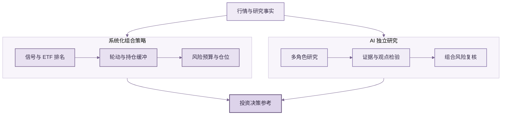

<div align="center">


# ETF Compass 🧭

### 系统化 ETF 策略与 AI 研究框架

**围绕收益机会识别与下行风险管理，结合策略信号、组合控制和 AI 研究，形成可扩展的 ETF 投资决策流程。**

ETF Compass 是开源 Python 工具包，集成多策略信号、ETF 轮动、动态仓位、组合风险控制与 AI 多角色研究，并支持接入自定义策略、行情和模型。

[](https://www.python.org/)
[](LICENSE)
[](#测试)

[快速开始](#快速开始) · [策略与 AI](#策略与-ai-如何配合) · [公开研究案例](#可复现研究案例) · [English](#english-version)

</div>

规则策略负责信号计算、标的筛选、组合构建和仓位控制；AI 研究基于接入的行情与资料整理证据、检验观点并评估风险。两类输出相互补充，支持投资者进行更系统的 ETF 研究与组合决策。

## 策略与 AI 如何配合

- **策略信号与轮动：** 趋势突破、动量、均值回归和波动突破等信号用于 ETF 评分与筛选；持仓缓冲控制排名边界附近的换手。
- **仓位与风险控制：** 根据历史波动估算仓位，设置单 ETF 权重和组合总敞口上限，并在约束后复核组合风险预算。
- **AI 研究评估：** 多角色流程整理证据、检验多空观点并形成结构化风险评估；AI 结论与策略权重分离。

策略与 AI 研究共同服务于收益机会评估和风险管理。回测表现不代表未来收益。

## 工作流程



行情与研究资料由调用方接入，并应符合决策时点的数据可得性。策略输出组合计划，AI 提供独立研究评估。

## 快速开始

需要 Python 3.11 或更新版本。离线示例使用固定随机种子的合成价格：

```bash
git clone https://github.com/BZX667/ETF-Compass.git
cd ETF-Compass
python -m pip install -e '.[dev]'
python examples/quickstart.py
```

该示例用于验证软件流程，不代表市场表现。项目未内置行情源或通用命令行程序。

## 可复现研究案例

公开案例固定 9 只沪深市场挂牌 ETF，涵盖宽基、跨境、黄金和债券品种，样本期为 2015–2024 年。策略以过去 126 个交易日的正动量进行排名，持有 Top 3，使用此前 20 日估算风险，按信号日后下一交易日收盘成交，并计入单边 6 bp 换手成本。

```bash
python -m pip install -e '.[research]'
python examples/china_etf_research_case.py
```

| 指标 | ETF 轮动 Top 3 | 沪深 300 ETF |
| --- | ---: | ---: |
| 累计收益 | 103.17% | 9.53% |
| 年化收益 | 8.07% | 1.00% |
| 夏普比率 (Sharpe) | 0.76 | 0.15 |
| 年化波动率 | 11.07% | 21.38% |
| 最大回撤 | -15.73% | -42.16% |

Top 2 敏感性结果：年化收益 6.89%，夏普比率 0.71。<br>
[查看净值曲线与完整回测口径](examples/results/china-etf-rotation-case.md)

<div align="center"></div>

结果基于固定标的范围和指定成本假设，可能存在幸存者偏差；跨境 ETF 的时差与溢价风险未被充分建模。历史回测不代表未来表现。

## 按需扩展，打造自己的 ETF Agent

策略、组合管理、AI 研究和报告模块均可扩展。使用者可配置因子与 ETF 范围，调整筛选、轮动和风险方法，并接入自选行情源与模型，构建适合自身研究流程的 ETF Agent。

## 日报与周复盘

项目提供日报与周度复盘渲染，以及邮件、微信推送函数。行情接入、模型配置、账户账本和定时任务由集成应用负责。

<div align="center">
  <a href="assets/report-preview.svg"></a>
  <br>
  <sub>日报样式预览 · 虚构示例 · <a href="assets/report-preview.svg">查看大图</a></sub>
</div>

## 测试

```bash
python -m pip install -e '.[dev]'
pytest
```

测试覆盖信号、组合约束、回测执行时序与成本、报告、推送和 AI 工作流输出校验。

## 项目范围

ETF Compass 是 ETF 研究与策略开发工具，不提供交易执行或投资建议，也不保证收益。回测结果受数据质量、标的范围、成本和执行假设影响；实盘使用前应进行独立验证。

## English version

### ETF Compass: systematic ETF strategies and AI research

An open, extensible Python framework for ETF research. Systematic signals identify rotation opportunities and guide portfolio sizing; independent AI research adds evidence review and risk assessment. Use the modules with your own strategies, market data, and models.

### Strategy and AI

The toolkit includes trend, momentum, mean-reversion, and volatility-breakout signals; ETF ranking and rotation; volatility-based position sizing; and a multi-role AI research workflow. AI assessments remain separate from strategy weights.

### Quick start

Requires Python 3.11+. The offline demo uses deterministic synthetic prices:

```bash
git clone https://github.com/BZX667/ETF-Compass.git
cd ETF-Compass
python -m pip install -e '.[dev]'
python examples/quickstart.py
```

### Historical case

The fixed 2015–2024 case covers nine ETFs listed in mainland China. It uses positive 126-session momentum, a Top 3 portfolio, 20-session risk estimates, next-session closing execution, and 6 bps one-way turnover costs.

| Metric | Rotation | CSI 300 ETF |
| --- | ---: | ---: |
| Cumulative return | 103.17% | 9.53% |
| Annualized return | 8.07% | 1.00% |
| Sharpe ratio | 0.76 | 0.15 |
| Annualized volatility | 11.07% | 21.38% |
| Maximum drawdown | -15.73% | -42.16% |

[Full report and assumptions](examples/results/china-etf-rotation-case.md). These are historical results under fixed assumptions, not forecasts. The retrospective universe may have survivorship bias, and cross-border ETF timing and premiums are not fully modeled.

### Extensions and reports

Add factors, ETF universes, portfolio methods, market-data connections, and model providers. The package also includes daily and weekly report rendering and email/WeChat delivery functions; data ingestion and scheduling are application integrations.

### Validation and scope

Run `pytest` to check signal, risk, backtest, reporting, notification, and AI workflow behavior. ETF Compass is a research tool, not a broker or investment adviser, and does not guarantee returns. Validate data quality, costs, and execution assumptions before live use.
