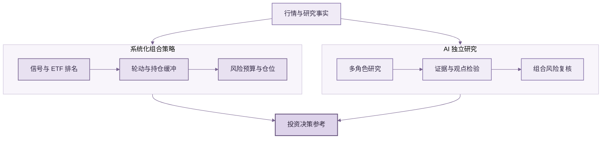

<div align="center">


# ETF Compass 🧭

### 系统化策略 + AI 研究，构建自己的 ETF Trading Agent

**系统化策略寻找收益机会、管理下行风险，AI 研究补足证据与判断，助你构建自己的 ETF 投资决策系统。**

一个开放、可扩展的 ETF 研究框架，组合多策略信号、ETF 轮动、动态仓位与 AI 多角色研究，支持你持续加入自己的策略、数据和模型。

[](https://www.python.org/)
[](LICENSE)
[](#测试)

[快速开始](#快速开始) · [策略与 AI](#策略与-ai-如何配合) · [公开研究案例](#可复现研究案例) · [English](#english-version)

</div>

ETF Compass 面向希望用系统化方法研究 ETF 的投资者与开发者。规则策略负责计算信号、筛选标的、形成组合并控制仓位；AI 研究补充市场证据、检验不同观点、提示风险。两者各自发挥优势，为投资决策提供更完整的参考。项目提供可扩展的 Python 组件，方便你按自己的方法继续 DIY。

## 策略与 AI 如何配合

- **系统化策略寻找机会：** 趋势突破、动量、均值回归等信号参与 ETF 评分与轮动，持仓缓冲降低排名小幅变化带来的频繁切换。
- **组合管理关注风险：** 根据历史波动估算仓位，应用单 ETF 权重与组合总敞口限制，并在限制后重新复核风险预算。
- **AI 研究补充判断：** 多角色工作流整理依据、检验多空观点、复核风险并形成结构化评估；AI 观点与策略权重分开，供使用者综合判断。

策略与 AI 结合的目标，是把可重复执行的投资纪律与更广泛的研究视角放在同一决策流程中，帮助使用者评估机会和风险；历史表现不代表未来收益。

## 工作流程



行情与研究资料由使用者接入，并应覆盖决策时点可获得的信息。策略形成组合计划，AI 独立研究并给出评估，最终判断由使用者完成。

## 快速开始

需要 Python 3.11 或更新版本。离线示例使用固定随机种子的合成价格，安装后即可运行并看到回测摘要：

```bash
git clone https://github.com/BZX667/ETF-Compass.git
cd ETF-Compass
python -m pip install -e '.[dev]'
python examples/quickstart.py
```

这是软件运行示例，不是市场数据结果。项目目前没有通用命令行程序或内置行情源；使用真实市场数据请接入自己的数据，并确认数据与信号时点一致。

## 可复现研究案例

公开案例使用沪深市场挂牌的 9 只 ETF 复权日线数据，覆盖宽基、跨境、黄金和债券品种，固定研究区间为 2015–2024 年。策略按过去 126 个交易日的正动量评分，最多持有 3 只 ETF，以此前 20 日估算风险，模拟信号日之后的下一交易日收盘成交，并按单边换手计入 6 个基点成本。

```bash
python -m pip install -e '.[research]'
python examples/china_etf_research_case.py
```

[案例报告](examples/results/china-etf-rotation-case.md)显示，Top 3 组合在该样本中的累计收益为 103.17%、年化收益为 8.07%，沪深 300 ETF 对照年化收益为 1.00%；Top 2 参数下年化收益为 6.89%。组合年化波动率为 11.07%，最大回撤为 -15.73%。这是按固定 ETF 范围和明确成本假设得到的历史回测，不代表未来表现。标的范围为事后固定，可能存在幸存者偏差；跨境 ETF 受时差和溢价影响，本案例也未验证盘中成交。

## 按需扩展，打造自己的 ETF Agent

ETF Compass 提供可组合的策略、组合管理、AI 研究和报告模块。你可以加入自己的因子与 ETF 范围，调整筛选、轮动和风险方法，接入偏好的行情源与模型，逐步构建适合自己的 ETF Trading Agent。

## 日报与周复盘

项目包含日报与周度复盘渲染，以及邮件和微信渠道推送函数，便于把组合计划、AI 评估与阶段性结果纳入日常研究流程。行情接入、模型服务配置、账户账本与定时任务由集成应用负责。

<div align="center">
  <a href="assets/report-preview.svg"></a>
  <br>
  <sub>日报样式预览 · 虚构示例 · <a href="assets/report-preview.svg">查看大图</a></sub>
</div>

## 测试

```bash
python -m pip install -e '.[dev]'
pytest
```

测试覆盖信号、组合约束、回测执行时序与成本、报告、推送和 AI 工作流输出校验。

## 项目范围

ETF Compass 是 ETF 研究与策略开发框架，不是券商或投资顾问，也不保证收益。回测结果受到数据质量、标的范围、评估区间、交易成本和执行假设影响；用于实盘前，应结合真实市场规则独立验证。

## English version

### ETF Compass 🧭

#### Build your own AI-powered ETF Trading Agent

**Systematic strategies seek return opportunities and manage downside risk. AI research adds evidence and challenge to support more informed ETF decisions.**

ETF Compass is an open, extensible framework that combines multi-strategy signals, ETF rotation, portfolio sizing, and multi-role AI research. Bring your own strategies, market data, and models to keep shaping the agent around your approach.

### How strategy and AI work together

- **Systematic signals identify opportunities:** trend, momentum, and mean-reversion signals help rank and rotate ETFs. A holding buffer reduces unnecessary turnover near ranking cutoffs.
- **Portfolio controls manage risk:** volatility-based sizing applies per-ETF and total-exposure limits, then rechecks the risk budget after those constraints.
- **AI research adds another view:** a multi-role workflow organizes evidence, tests opposing arguments, reviews portfolio risks, and returns a structured assessment. AI commentary remains separate from strategy weights.

The goal is to combine repeatable investment discipline with broader research perspectives. Historical results do not predict future returns.

### Workflow

The workflow diagram above shows market facts feeding both the systematic portfolio process and independent AI research. The strategy forms a portfolio plan; AI reviews the evidence and risks; the user makes the final decision.

### Quick start

Requires Python 3.11 or later. The offline demo uses deterministic synthetic prices and prints a backtest summary:

```bash
git clone https://github.com/BZX667/ETF-Compass.git
cd ETF-Compass
python -m pip install -e '.[dev]'
python examples/quickstart.py
```

This demonstrates the software, not market performance. The project does not currently include a general-purpose CLI or market-data feed.

### Reproducible research case

The public case uses adjusted daily prices for nine ETFs listed in mainland China, spanning broad-market, cross-border, gold, and bond products, over a fixed 2015–2024 period. The strategy ranks positive 126-session momentum, holds up to three ETFs, estimates risk over the prior 20 sessions, executes at the following session's close, and charges 6 bps per one-way turnover.

```bash
python -m pip install -e '.[research]'
python examples/china_etf_research_case.py
```

The [case report](examples/results/china-etf-rotation-case.md) shows 103.17% cumulative return and 8.07% annualized return for the Top 3 portfolio, compared with 1.00% annualized return for the CSI 300 ETF. A Top 2 sensitivity run returned 6.89% annualized. These are historical backtest results under fixed assumptions, not forecasts. The retrospective fixed universe may have survivorship bias; cross-border ETF timing and premiums are not fully modeled.

### Customize your ETF Agent

Add your factors and ETF universe, adapt the selection, rotation, and risk methods, and connect your preferred market-data and model services. ETF Compass provides composable Python modules for continued experimentation.

### Daily and weekly reports

The package includes daily and weekly report rendering plus email and WeChat delivery functions. Market-data ingestion, model configuration, account records, and scheduled jobs are integrations for the application using the package. The report preview above contains fictional example values.

### Tests

```bash
python -m pip install -e '.[dev]'
pytest
```

Tests cover signals, portfolio constraints, backtest timing and costs, reports, notifications, and AI workflow output validation.

### Scope

ETF Compass is a research and strategy-development framework, not a broker or investment adviser, and it does not guarantee returns. Backtest results depend on data quality, universe selection, evaluation windows, transaction costs, and execution assumptions. Independently validate a strategy before using it live.
