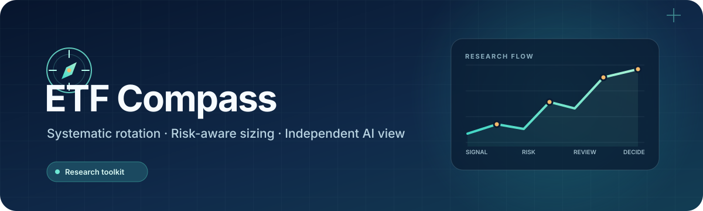
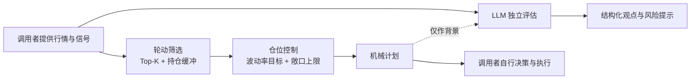

<div align="center">



### 让规则负责组合，让 AI 提供独立视角

一个模块化的 ETF 投资研究 Agent：机械轮动、仓位风险控制与 LLM 评估，各自有清晰边界。

[](https://www.python.org/)
[](LICENSE)
[](#项目状态)

**[English](#english)** · **[快速开始](#快速开始)** · **[系统设计](#系统设计)**

</div>

ETF Compass 是一个轻量、可审阅的 Python 工具包，用于搭建 ETF 研究流程。调用者提供行情和策略评分；规则模块筛选候选并计算风险受限的目标权重；LLM 根据给定事实形成独立评估。AI 意见不会改变机械计划，也不会触发交易。

## 系统设计



| 模块 | 做什么 | 保持的边界 |
| --- | --- | --- |
| 轮动筛选 | 根据调用者提供的分数选出 Top-K，并支持持仓缓冲 | 不拉取行情、不替用户生成分数 |
| 仓位控制 | 根据历史波动估算权重，并限制单资产和总敞口 | 输入必须截止于计划执行期之前 |
| LLM 评估 | 生成受约束的评估提示，并校验结构化回复 | 不改写机械计划、不下单 |

## 快速开始

需要 Python 3.11 或更高版本。

```bash
git clone https://github.com/BZX667/ETF-Compass.git
cd ETF-Compass
python -m pip install -e '.[dev]'
```

## 示例

```python
import pandas as pd

from etf_compass import select_assets, volatility_target_weights
from etf_compass.evaluation import build_assessment_prompt, parse_assessment

# 分数由你的策略根据决策时可见的数据计算。
scores = pd.Series({"ETF_A": 0.9, "ETF_B": 0.7, "ETF_C": 0.5})
selected = select_assets(scores, top_k=2, held=["ETF_B"], buffer_multiple=1.5)

# 收益数据截至计划执行期之前。
returns = pd.DataFrame(
    {
        "ETF_A": [0.010, -0.004, 0.006, 0.002] * 5,
        "ETF_B": [0.003, 0.005, -0.002, 0.004] * 5,
        "ETF_C": [-0.006, 0.002, 0.001, 0.003] * 5,
    }
)
weights = volatility_target_weights(
    returns, selected, target_volatility=0.15, lookback=20, max_weight=0.35
)

prompt = build_assessment_prompt(
    market_facts="在这里填写已核实的市场事实。",
    mechanical_plan=f"候选标的：{selected}",
)
# 将 prompt 交给你配置的模型服务，再校验其回复：
# assessment = parse_assessment(provider.complete(prompt))
```

## 安装后包含什么

- **规则轮动**：Top-K 选择、持仓缓冲，方便接入自己的策略评分。
- **仓位与风险控制**：逆波动权重、目标波动率、单资产和组合敞口上限。
- **LLM 评估接口**：不绑定模型厂商，包含提示词构造和 JSON 结果校验。
- **可独立验证**：核心逻辑有测试；行情源、账户和执行由调用者自行管理。

## 开发

```bash
python -m pytest
```

## 项目状态

ETF Compass 目前处于研究原型阶段，接口可能随验证继续调整。欢迎基于自己的数据源和研究假设扩展；请先独立检查数据、执行时点、成本和样本外表现。

## 风险说明

本项目仅用于技术研究，不构成证券投资建议、交易邀约或收益承诺。市场有风险，策略和模型输出都可能产生损失；历史表现不代表未来结果。

---

<a id="english"></a>

## English

ETF Compass is a lightweight Python toolkit for ETF research workflows. You provide market data and strategy scores. Transparent rules select candidates and size risk-limited weights; an optional LLM assessment reviews supplied facts independently. The model cannot override the mechanical plan or place trades.

**Core modules:** buffered Top-K rotation, volatility-aware position sizing, and provider-neutral structured LLM assessment. No brokerage integration, account storage, or bundled market-data feed is included.

See [Quick start](#快速开始), [System design](#系统设计), and the runnable [example](#示例) above. Research software only; no investment advice or return guarantees.
