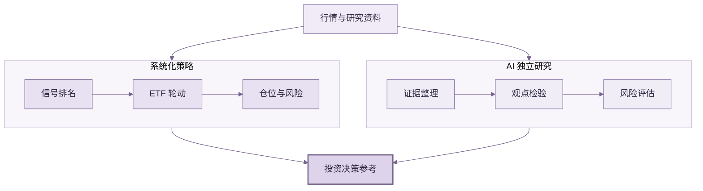

<div align="center">


# ETF Compass 🧭

### 系统化 ETF 策略与 AI 研究

**策略识别收益机会，组合管理下行风险，AI 研究补充证据与观点。**

开源、可扩展的 ETF Python 研究框架，支持多策略信号、ETF 轮动、动态仓位与多角色 AI 研究。

[](https://www.python.org/)
[](LICENSE)
[](#验证与范围)

[快速开始](#快速开始) · [策略与 AI](#策略与-ai) · [回测案例](#a-股-etf-轮动案例) · [English](#english)

</div>

## 策略与 AI

- **系统化策略：** 趋势、动量、均值回归和波动突破信号用于 ETF 排名与轮动。
- **组合风控：** 基于历史波动配置仓位，限制单项权重和组合总敞口。
- **AI 研究：** 多角色流程整理证据、检验观点并复核风险；AI 结论与策略权重分开。

策略负责组合信号与仓位，AI 研究提供独立评估。使用者可替换策略、行情和模型，按需扩展。

## 工作流程



## 快速开始

需要 Python 3.11+。离线示例使用固定随机种子的合成价格：

```bash
git clone https://github.com/BZX667/ETF-Compass.git
cd ETF-Compass
python -m pip install -e '.[dev]'
python examples/quickstart.py
```

该示例验证软件流程，不代表市场表现；项目未内置行情源或通用 CLI。

## A 股 ETF 轮动案例

固定 9 只沪深市场挂牌 ETF，样本期 2015–2024 年；按 126 日正动量排名，持有 Top 3，使用 20 日风险估算、次日收盘成交和单边 6 bp 换手成本。

| 指标 | ETF 轮动 Top 3 | 沪深 300 ETF |
| --- | ---: | ---: |
| 累计收益 | 103.17% | 9.53% |
| 年化收益 | 8.07% | 1.00% |
| 夏普比率 | 0.76 | 0.15 |
| 年化波动率 | 11.07% | 21.38% |
| 最大回撤 | -15.73% | -42.16% |

Top 2 敏感性结果：年化收益 6.89%，夏普比率 0.71。<br>
[完整回测口径与净值曲线](examples/results/china-etf-rotation-case.md)

<div align="center"></div>

该结果来自固定标的范围和成本假设，可能存在幸存者偏差；跨境 ETF 的时差与溢价风险未被充分建模。历史回测不代表未来收益。

## 扩展与报告

可接入自定义因子、ETF 范围、组合规则、行情和模型。项目还提供日报、周度复盘渲染及邮件/微信推送函数；数据接入和定时运行由集成应用负责。

<div align="center">
  <a href="assets/report-preview.svg"></a>
  <br><sub>日报样式预览 · 虚构示例 · <a href="assets/report-preview.svg">查看大图</a></sub>
</div>

## 验证与范围

```bash
python -m pip install -e '.[dev]'
pytest
```

ETF Compass 是研究工具，不提供交易执行或投资建议，也不保证收益。使用真实资金前，应独立验证数据、成本与执行假设。

## English

ETF Compass is an open Python framework for systematic ETF research and AI-assisted analysis. It combines signals, ETF rotation, portfolio risk controls, and independent multi-role research. Extend it with your own strategies, data, and models.

The 2015–2024 ETF rotation case reports 8.07% annualized return, 0.76 Sharpe, and -15.73% maximum drawdown, compared with 1.00%, 0.15, and -42.16% for the CSI 300 ETF. [See the full backtest and assumptions](examples/results/china-etf-rotation-case.md). Historical results do not predict future returns.

Quick start: `python -m pip install -e '.[dev]'` then `python examples/quickstart.py`. The package also includes daily/weekly report rendering and email/WeChat delivery functions. It is a research toolkit, not an investment adviser or broker.
