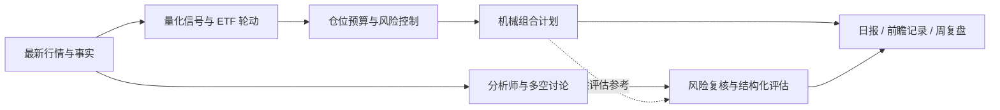

<div align="center">


### 让策略保持纪律，让 AI 分析拓展视角

**ETF Compass 是一个面向 ETF 研究的开源 Python 工具包：量化策略生成可复核的组合计划，AI 多视角分析补充证据、挑战假设并识别风险。**

[](https://www.python.org/)
[](LICENSE)
[](#项目状态)

[English](#english) · [快速开始](#快速开始) · [报告与推送](#报告与推送)

</div>

机械策略提供一致、可测试的规则；AI 分析整合技术、资金与产业事实，经过多空讨论和风险复核后给出独立评估。两者优势互补：策略负责组合信号与仓位约束，AI 帮助扩大研究视角；AI 观点不会覆盖机械信号，也不会自动下单。

## 工作流程



## 机械策略 + AI 分析

<table width="100%">
  <thead>
    <tr>
      <th align="left" width="30%">机械策略</th>
      <th align="left" width="70%">核心作用</th>
    </tr>
  </thead>
  <tbody>
    <tr>
      <td align="left" valign="top"><strong>海龟通道突破</strong></td>
      <td align="left" valign="top">跟踪价格突破近期区间及趋势退出信号。</td>
    </tr>
    <tr>
      <td align="left" valign="top"><strong>标准化动量、双动量</strong></td>
      <td align="left" valign="top">比较 ETF 相对强度，并过滤绝对动量为负的标的。</td>
    </tr>
    <tr>
      <td align="left" valign="top"><strong>RSI 均值回归</strong></td>
      <td align="left" valign="top">识别短期超卖状态与潜在修复信号。</td>
    </tr>
    <tr>
      <td align="left" valign="top"><strong>ATR 波动率突破</strong></td>
      <td align="left" valign="top">结合均线和真实波幅跟踪趋势变化。</td>
    </tr>
  </tbody>
</table>

多信号可等权合议，用于横截面排名和 Top-K 轮动；持仓缓冲减少排名边缘的频繁切换。仓位模块按历史波动估算风险目标，并限制单项权重和组合总敞口。计算信号时应使用决策时点可获得的数据，并按实际执行时点评估结果。

AI 工作流由事实分析、多空研究、风险审查和组合经理总结组成，输出立场、信心、证据、风险与观察项。相关项目：[TradingAgents](https://github.com/TauricResearch/TradingAgents)。模型供应商由调用方提供的 `complete(prompt)` 适配器接入；可使用兼容 API 或本地模型。模型意见仅作研究参考。

## 报告与推送

工具包提供日报/周报渲染和推送函数：

- `render_daily_report(...)` 汇总行情时间、轮动排名、目标权重、AI 评估与风险提示；账户持仓或盈亏只会在调用方明确传入时加入。
- `score_forward_observations(...)` 和 `render_weekly_review(...)` 按保存的决策时点观点与已结束的前瞻区间生成周度评估，展示样本数、方向命中率和相对基准的平均方向性超额。
- `send_report(...)` 可将报告发送到一个或多个渠道；SMTP 邮件、Server酱微信通知和企业微信群机器人均从运行环境读取凭据。

行情供应商、账户账本、观点快照存储和定时调度由部署应用接入。应用应先拉取最新可用行情，并在报告中注明数据时间与覆盖情况；周复盘只纳入评估期已结束的样本，避免前视偏差。公开包不包含用户的邮箱地址、邮箱密码、微信 SendKey、Webhook、账户或交易记录。

### 私密配置

推送密钥只在运行环境中配置，不写入代码、README、日志或 Git：

| 渠道 | 环境变量 |
| --- | --- |
| 邮件 | `SMTP_HOST`、`SMTP_PORT`、`SMTP_USER`、`SMTP_PASSWORD`、`REPORT_TO` |
| 个人微信通知（Server酱） | `SERVERCHAN_SENDKEY` |
| 企业微信群机器人 | `WECOM_BOT_WEBHOOK` |

Server酱发送到绑定的个人微信；企业微信 Webhook 发送到配置好的企业微信群。[Server酱 SendKey 说明](https://sct.ftqq.com/docs/getting-started/sendkey/) · [企业微信消息推送文档](https://developer.work.weixin.qq.com/document/path/91770)。发送失败信息不会包含凭据或完整 Webhook 地址。调用方应自行确认报告收件人及报告中是否包含私人账户信息。

## 快速开始

需要 Python 3.11 或更高版本：

```bash
git clone https://github.com/BZX667/ETF-Compass.git
cd ETF-Compass
python -m pip install -e '.[dev]'
python -m pytest
```

以下是应用侧集成示意。策略函数接收调用方准备的行情面板，不直接连接行情供应商：

```python
from etf_compass import (
    equal_weight_ensemble, momentum_score, select_assets,
    volatility_target_weights, turtle_breakout,
)
from etf_compass.agents import run_trading_agents_review
from etf_compass import render_daily_report, send_report

signals = {"momentum": momentum_score(close), "turtle": turtle_breakout(close)}
scores = equal_weight_ensemble(signals).iloc[-1].dropna()
selected = select_assets(scores, top_k=4, held=current_holdings, buffer_multiple=1.25)
weights = volatility_target_weights(returns, selected, max_weight=0.35)

review = run_trading_agents_review(
    facts={"technical": technical_facts, "industry": industry_facts},
    mechanical_plan=f"Target weights: {weights.to_dict()}",
    complete=my_model_adapter,  # credentials stay in the calling application
)
report = render_daily_report(
    as_of=report_date,
    market_data_as_of=quote_timestamp,
    rotation=[{"symbol": symbol, "score": scores[symbol], "weight": weights[symbol]} for symbol in selected],
    assessment=review.assessment,
)
send_report("ETF daily research", report, channels=("email", "serverchan"))
```

周复盘可使用 `ForwardObservation` 保存每次观点的观察日、评估结束日、立场、标的收益和基准收益，再调用 `score_forward_observations(..., as_of=review_date)` 与 `render_weekly_review(...)`。收益区间必须从观察日之后开始，并统一基准和持有期；仅已结束的样本进入评分。

## 项目状态与风险说明

ETF Compass 处于研究原型阶段。它不提供交易执行，也不保证收益。数据质量、幸存者偏差、评估窗口、交易成本和执行时点都会影响结果；应独立验证策略和 AI 输出，不把历史表现视为未来保证。本项目不构成投资建议。

---

<a id="english"></a>

## English

**ETF Compass is an open-source Python toolkit for ETF research, combining systematic rotation and risk controls with AI-assisted analysis.** It includes daily and weekly report helpers, with optional email and WeChat delivery. Market data, model access, credentials, and scheduling are supplied by the deploying application; no personal keys, account details, or trading records are included. The project is a research prototype and does not execute trades or provide investment advice.
