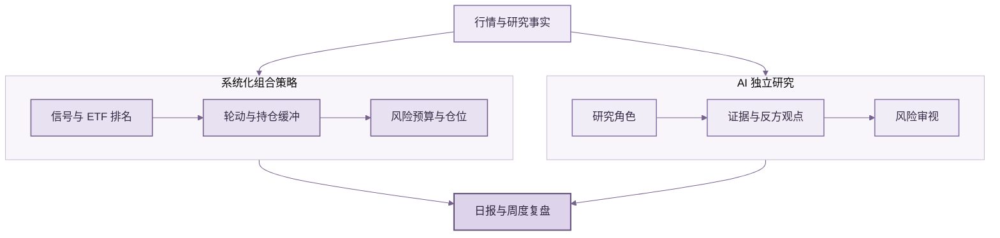

<div align="center">


# ETF Compass 🧭

### 构建你自己的 AI ETF Trading Agent

**一个开放、可扩展的 ETF 研究框架，结合系统化策略、组合风险控制与 AI 独立研究。**

系统化信号，独立 AI 研究，决策由你掌握。

[](https://www.python.org/)
[](LICENSE)
[](#测试)

[English](README.md) · [快速开始](#快速开始) · [可复现研究案例](#可复现研究案例)

<a href="assets/report-preview.svg"></a>

<sub>日报样式示例 · 虚构数据 · <a href="assets/report-preview.svg">查看大图</a></sub>

</div>

ETF Compass 将规则化 ETF 筛选与仓位管理，同 AI 研究流程结合起来。策略生成可复核的组合计划；AI 检查证据、反方观点与组合风险，提供独立研究结论，不改写策略权重，也不执行交易。

## 工作流程



策略规则确定候选组合，AI 独立审视相关证据与风险。项目提供日报、周度复盘渲染和推送渠道函数；行情接入、模型凭据和定时任务由集成应用配置。

## 快速开始

需要 Python 3.11 或更新版本。离线示例使用固定随机种子的合成数据，运行后会打印完整回测摘要：

```bash
git clone https://github.com/BZX667/ETF-Compass.git
cd ETF-Compass
python -m pip install -e '.[dev]'
python examples/quickstart.py
```

这是可运行的软件示例，不是市场数据结果，也不代表投资表现。项目目前不提供通用命令行程序或内置行情源。

## 可复现研究案例

运行固定在 2010–2024 年的历史研究案例，使用五只存续时间较长的美国上市 ETF 复权日线价格。策略采用过去 126 个交易日的正动量，最多选择两只 ETF，使用此前 20 日估算风险，按下一交易日收盘成交建模，并按单边换手计入 6 个基点成本。脚本下载公开行情，并将报告、日期区间、假设和对齐后价格面板的哈希写入文件。

```bash
python -m pip install -e '.[research]'
python examples/public_research_case.py
```

[已保存的研究结果](examples/results/public-etf-research-case.md)显示，该样本中轮动示例年化收益为 6.46%，SPY 对照为 5.11%。数据通过 [yfinance](https://ranaroussi.github.io/yfinance/reference/api/yfinance.download.html) 获取自 [Yahoo Finance](https://finance.yahoo.com/quote/SPY/history/) 的复权日线。这只是一次历史案例，不代表经过独立验证的策略，也不能作为未来表现的依据。Yahoo Finance 可能更新历史数据，后续下载结果可能变化。该案例使用美国市场日线，未验证盘中、A 股或 QDII 执行。

## 已包含的能力

- **系统化策略：** 趋势突破、标准化动量、双动量、RSI 均值回归和 ATR 突破信号；基于评分的 ETF 轮动与持仓缓冲；带单项权重和总敞口限制的目标波动率仓位。
- **历史研究：** 日频轮动回测，支持收盘信号、次日收盘执行、换手成本、基准对照和绩效摘要；行情与评分由调用方提供。
- **AI 研究：** 可接入模型的多角色研究流程，涵盖证据整理、不同观点、风险复核和结构化结论；模型调用函数由使用者提供，项目不附带模型供应商或 API 密钥。
- **报告能力：** Markdown/HTML 日报、周度前瞻观点复盘，以及邮件/微信推送函数。行情采集、账户账本和定时运行仍由应用接入。

## 按需扩展，打造自己的 ETF Agent

接入自己的因子、ETF 范围、组合规则、行情和 AI 模型，按照自己的研究思路组合并持续 DIY。

## 测试

```bash
python -m pip install -e '.[dev]'
pytest
```

测试覆盖信号、组合约束、执行时序与成本、报告渲染、推送行为和 AI 工作流输出校验。

## 项目范围

ETF Compass 是研究框架，不是券商或投资顾问。历史结果会受到数据质量、标的范围、评估区间、执行假设和交易成本影响。用于实盘前，请独立验证策略。
