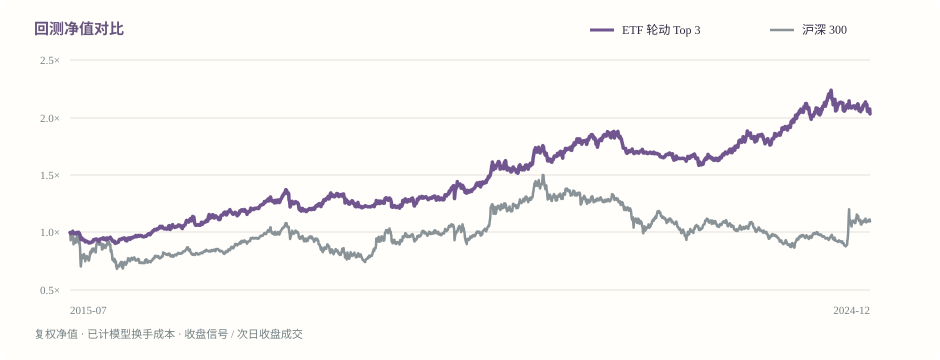

# A 股市场挂牌 ETF 动量轮动回测案例

## 净值曲线

  

## 主要结果

| 指标 | ETF 轮动（Top 3） | 沪深 300 ETF 持有 |
| --- | ---: | ---: |
| 累计收益 | 103.17% | 9.53% |
| 年化收益 | 8.07% | 1.00% |
| 年化波动率 | 11.07% | 21.38% |
| 夏普比率 | 0.76 | 0.15 |
| 最大回撤 | -15.73% | -42.16% |

Top 2 敏感性结果：累计收益 83.74%，年化收益 6.89%，夏普比率 0.71。

## 复现口径

- 样本期：2015-07-13 至 2024-12-31；固定数据请求区间为 2015-01-01 至 2025-01-01（结束日期不含）。
- ETF 范围：510050 上证50, 510300 沪深300, 510500 中证500, 159915 创业板, 513100 纳指100 QDII, 513500 标普500 QDII, 513030 德国DAX QDII, 518880 黄金, 511010 国债。
- 信号：过去 126 个交易日正动量；选择排名靠前的 3 只，非正动量标的不持仓。
- 时序：T 日收盘生成评分，T+1 日收盘模拟成交，之后开始计算持仓收益；不使用同日收盘价成交。
- 仓位：此前 20 日估算波动，年化目标 12%，单 ETF 上限 35%，组合总敞口不超过 100%。
- 成本：按单边换手计 6 bp；未包含买卖价差、冲击、税费、申赎成本、QDII 溢价波动及基金费用。
- 交易日数：2302；平均单日换手：11.86%；估算累计成本：23.82%（占初始资金估算）。
- 对齐后复权收盘价面板 SHA-256：`b3d0de3e861ea3aea4dbedc42db9c900637751123a993a425523531a40c576f4`。
- 数据可能被修订；再次下载的哈希和结果可能变化。QDII 受跨市场时差及溢价影响，本例不等同于对其净值或盘中成交的验证。

这是固定 ETF 范围上的历史回测演示，存在标的选择偏差的可能，不能据此推断未来收益，也不是投资建议。
